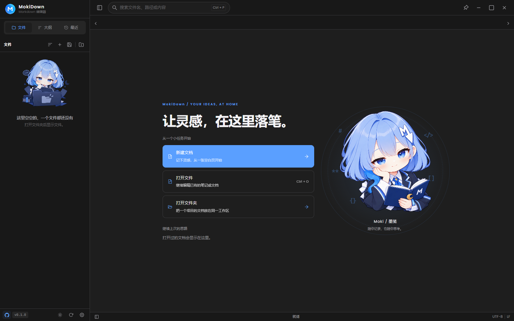
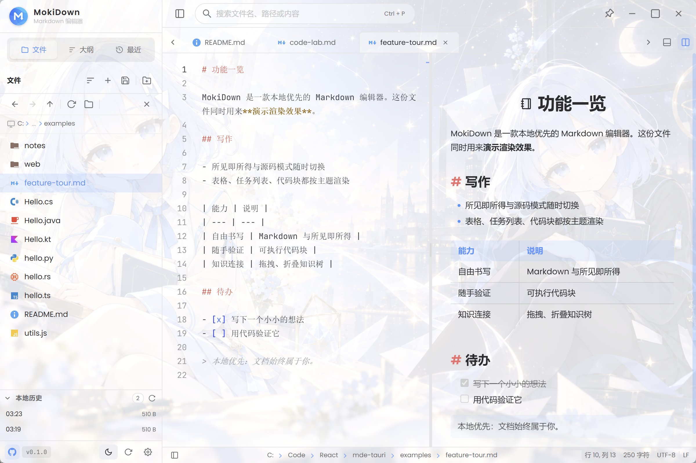
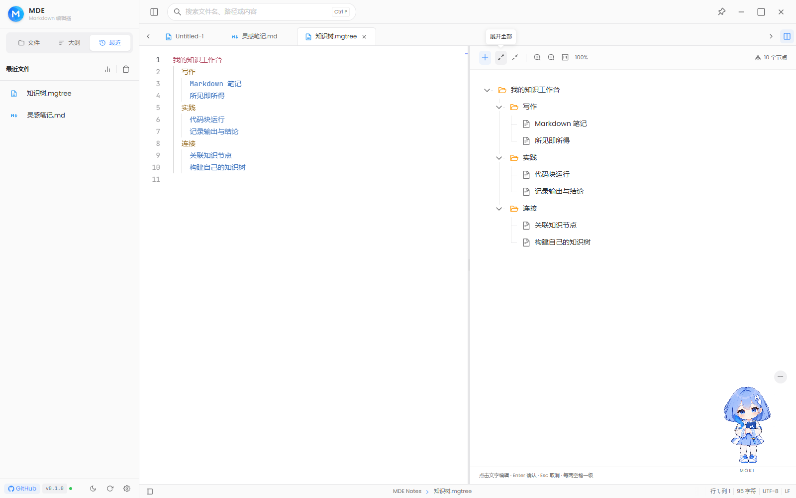
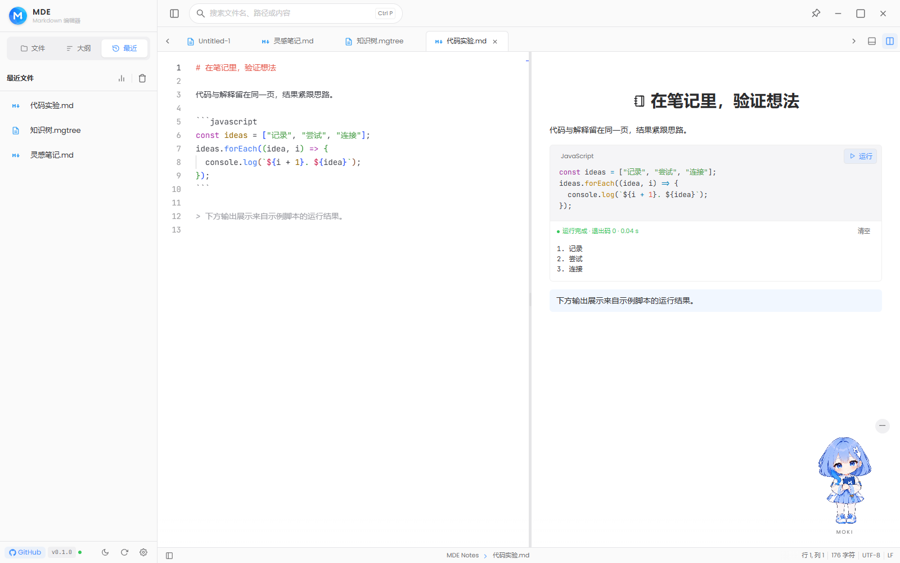
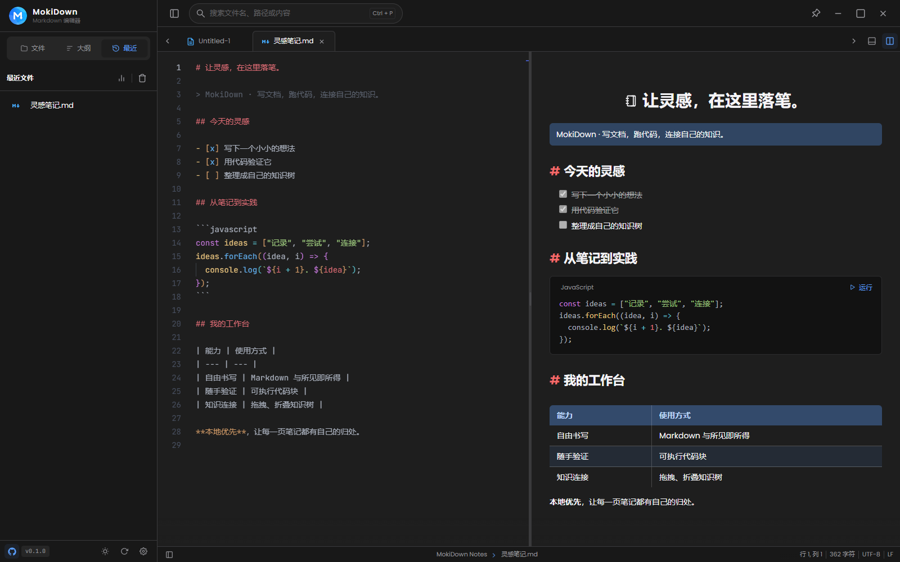
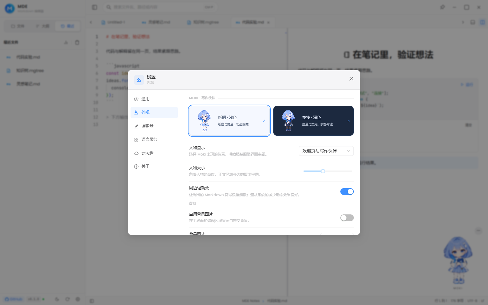

<p align="center">
  
</p>

<h1 align="center">MokiDown</h1>

<p align="center">本地优先的个人工作台：写作、代码、版本与知识整理都在一个窗口里。</p>

<p align="center">
  <a href="LICENSE"></a>
  
  
</p>

<p align="center">
  <a href="https://www.miaogu.xyz/">在线体验</a> ·
  <a href="https://github.com/hhyufan/mde-tauri/releases">下载</a> ·
  <a href="#-界面截图">截图演示</a> ·
  <a href="#快速开始">快速开始</a> ·
  <a href="docs/Function/README.md">功能文档</a> ·
  <a href="README_EN.md">English</a>
</p>

## 简介

MokiDown 是一个 **本地优先的个人工作台**。

它从 Markdown 编辑出发，但已经不止于编辑：文件、代码、版本历史、插件与阅读视图围绕同一份本地工作区组织起来，日常的「写 → 跑 → 对比 → 回滚」可以留在同一个窗口里完成，不需要把内容在多个工具之间搬来搬去。

工作台按四条原则组织：

* **文件是事实来源**：直接读写本地文件，不引入私有数据库；换一台机器，工作区照样能打开。

* **工作流留在原地**：编辑、运行代码、看 Git 变动、对比历史版本、写回文件，都在同一个工作区里完成。

* **扩展而不是堆功能**：语言服务、同步、文件图标、Markdown 样式等能力通过插件接入，核心保持轻量。

* **默认离线**：无需登录、无需联网；历史和版本都留在本机。

<p align="center">
  
</p>

## 工作台能力

### 写作与渲染

* **三种编辑模式**：源码、所见即所得与分屏，支持 GFM、LaTeX 公式和 Mermaid 图表。

* **虚拟渲染**：行内代码、粗体、斜体、删除线、链接与公式按渲染效果显示，定界符随光标显隐。

* **公式**：行内公式提供 KaTeX 实时预览气泡、符号补全与成对手势输入；块级公式与预览共用排版。

* **Markdown 预览**：表格、任务列表、脚注、引用、图片、Mermaid、KaTeX；代码块自动折行，不再横向滚动。

* **折叠与大纲**：标题、任务列表、普通列表与代码块均可折叠；大纲跟随光标。

* **排版细节**：Monaco 与代码块共用彩虹缩进（自动识别 2 / 4 空格缩进单位），编辑器与预览统一使用蓝色 I 形光标。

### 代码与执行

* **可执行代码块**：桌面端可运行 C#、JavaScript、Python、Java、Kotlin、Rust，支持输出、交互输入与停止；需安装对应语言环境。

* **语言服务**：按需安装 LSP 插件，提供代码补全、悬停提示与诊断。

* **源码编辑**：Monaco 提供多光标、查找替换、折叠与代码跳转。

* **终端**：集成终端可直接在当前工作区里执行命令。

* **命令面板**：常用操作、文件跳转与视图切换集中在一个入口。

### 版本与历史

* **Git 工作区**：变动面板按文件修改时间列出暂存区与工作区变更，自动监听仓库变化；支持 Markdown 过滤、分支切换与在 GitHub 打开。

* **历史对比**：Markdown 文件默认进入渲染对比，右侧可编辑，支持逐行撤销、保存与撤销全部更改；对比拥有独立标签页，不覆盖正在编辑的文件。

* **本地历史**：文件的历史快照与版本列表保留在本机，可回滚到任意版本。

* **Git 文件历史**：按文件追踪本地分支、远程跟踪分支与当前检出的提交，并跟随重命名前后的路径。

### 扩展与插件

* **插件 SDK**：版本化能力清单与权限模型（命令、文档 / 选区读写、工作区文件、网络、插件存储、状态栏、文件图标、通知、Markdown 样式、主题）。

* **内置插件**：增量同步（独立实现，默认关闭）与插件面板（安装、启用、禁用与配置）。

* **扩展点**：命令、状态栏、文件图标、Markdown 样式、通知、主题监听与生命周期清理。

### 文件与工作区

* **多标签页**：同时打开多个文件与对比视图，标签页之间互不覆盖。

* **文件树与项目树**：目录浏览、面包屑跳转、右键菜单与文件操作。

* **检索与定位**：全局搜索、大纲、书签与最近文件。

* **自动保存**：外部修改检测与冲突处理，本地历史兜底。

* **阅读与分屏**：多窗口阅读器、网页分屏与 HTML 实时预览。

* **知识树**：用 `.mgtree` 整理笔记层级，支持节点编辑与跳转到文档代码块。

* **导入方式**：文件拖入、图片插入与 Markdown 粘贴转换。

### 个性化与移动端

* **主题与外观**：明暗主题、壁纸与透明度、中英双语、字体 / 行高 / 缩进宽度。

* **操作偏好**：快捷键自定义、命令面板与设置搜索。

* **Android**：响应式布局与文件访问差异，构建方式见下文。

## 📸 界面截图

|                晴笺 · 浅色欢迎页               |               夜读 · 深色欢迎页               |
| :-------------------------------------: | :------------------------------------: |
|  |  |

|     三模式编辑（源码 / WYSIWYG / 分屏）     |          树编辑器（mgtree）         |
| :------------------------------: | :---------------------------: |
|  |  |

|                代码块运行               |
| :--------------------------------: |
|  |

|                 深色编辑                 |                 外观与角色设置                |
| :----------------------------------: | :------------------------------------: |
|  |  |

截图来自运行中的实际界面，使用示例文档；代码输出使用演示数据展示真实组件，不代表浏览器可启动桌面执行引擎。[移动端欢迎页](screenshots/welcome-mobile.png) · [设计与截图说明](docs/character-design/moki-integration.md)

## 安装

前往 [Releases](https://github.com/hhyufan/mde-tauri/releases) 查看可用安装包，Windows 推荐 EXE（NSIS），也可使用 MSI。其他平台的安装包以发布页实际提供为准。

[在线体验](https://www.miaogu.xyz/) 可免安装查看界面；浏览器演示不具备桌面端的本地代码执行能力。Android 的文件访问与本地脚本运行等能力也有差异。

## 快速开始

官方增量同步服务作为独立插件内置于 **设置 → 语言服务 → 服务插件**，默认关闭，无需账号登录。配置自己的服务地址、访问密钥和目录即可启用；实现代码保持独立，关闭后不运行。[插件说明](plugins/README.md) · [Linux 部署与数据库配置](services/sync-server/README.md) · [API 对接文档](services/sync-server/docs/API.md)

### 本地开发

准备 Node.js（推荐与 CI 一致的 22）、Rust 稳定版及对应平台的 Tauri 构建依赖。Windows 还需 MSVC C++ 工具链、Windows SDK 与 WebView2。

在仓库根目录执行：

```bash
npm ci --legacy-peer-deps
npm run tauri:dev
```

仅调试前端可运行 `npm run dev`。常用命令：

| 命令                    | 用途                        |
| --------------------- | ------------------------- |
| `npm run build`       | 构建前端与在线展示入口               |
| `npm run tauri:build` | 打包 Windows 桌面端（React 安装器） |
| `npm run check`       | 执行 lint、测试、构建与体积检查        |

桌面安装包输出到 `src-tauri/target/release/react/`。示例文档与代码见 [examples](examples/README.md)。

### Android 构建

安装 Android Studio（SDK / NDK / Build Tools）和 JDK 17–21，配置 `JAVA_HOME` 与 `ANDROID_HOME` 后执行：

```bash
npm run tauri:android:init
npm run tauri:android:build
```

### 云同步（已归档）

云同步实现已从主项目移除，归档在 [archive/cloud-sync](archive/cloud-sync/README.md) 供日后参考或独立开源。MokiDown 现在完全本地运行，不需要任何服务端，也不会上传你的文档。

## 文档与贡献

* [功能文档](docs/Function/README.md) · [语言服务](docs/语言服务.md) · [本地脚本运行](docs/本地脚本运行.md)

* [示例工作区](examples/README.md) · [快捷键](examples/notes/shortcuts.md) · [更多截图](screenshots/)

* 欢迎通过 [Issues](https://github.com/hhyufan/mde-tauri/issues) 反馈问题或提交 Pull Request。

本项目采用 [MIT 许可证](LICENSE)。
