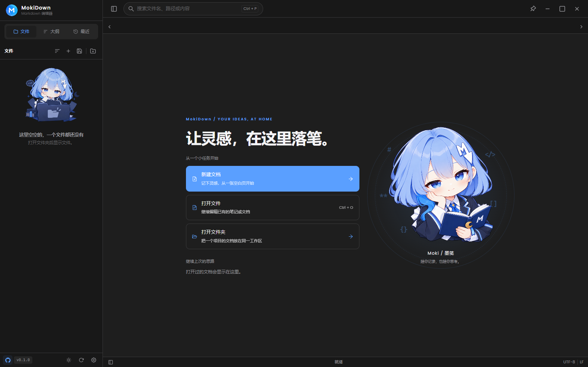
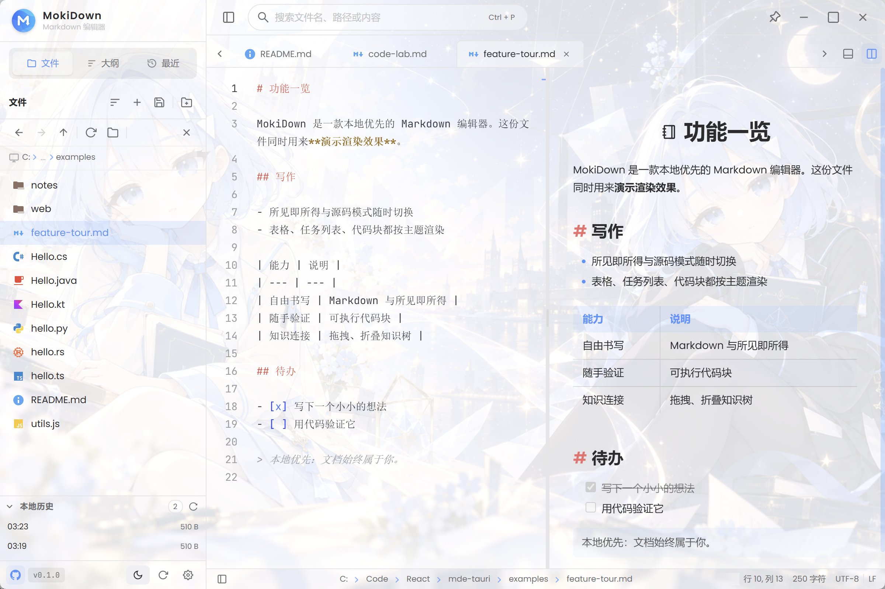
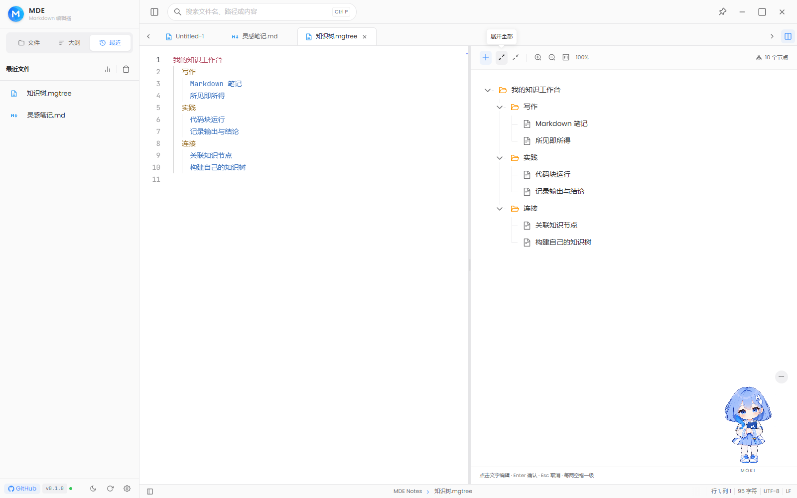
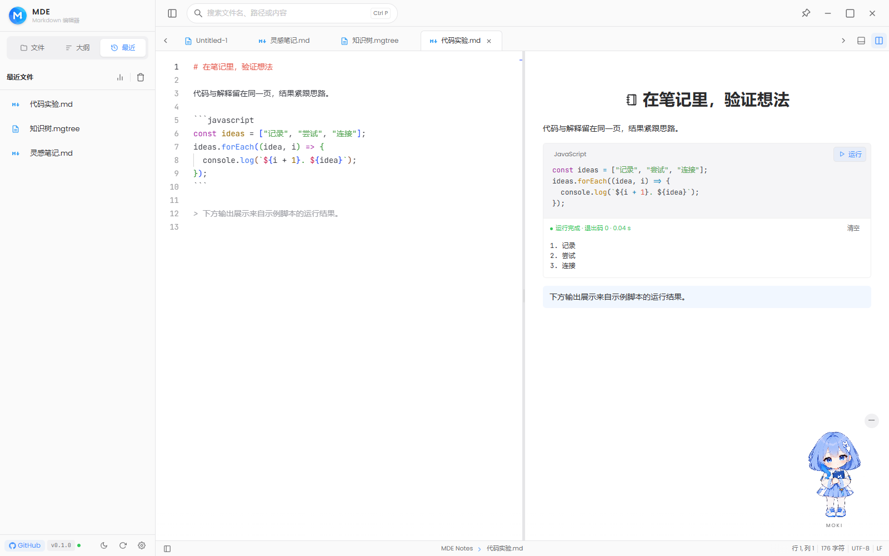
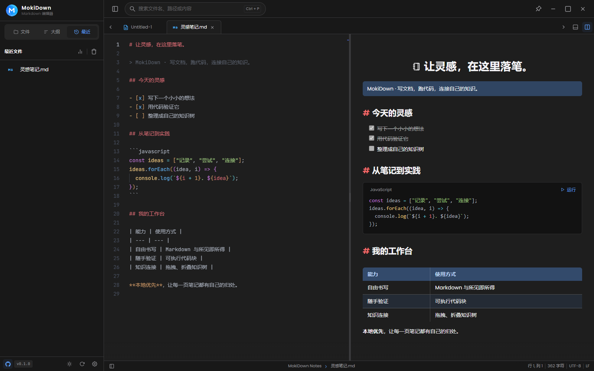
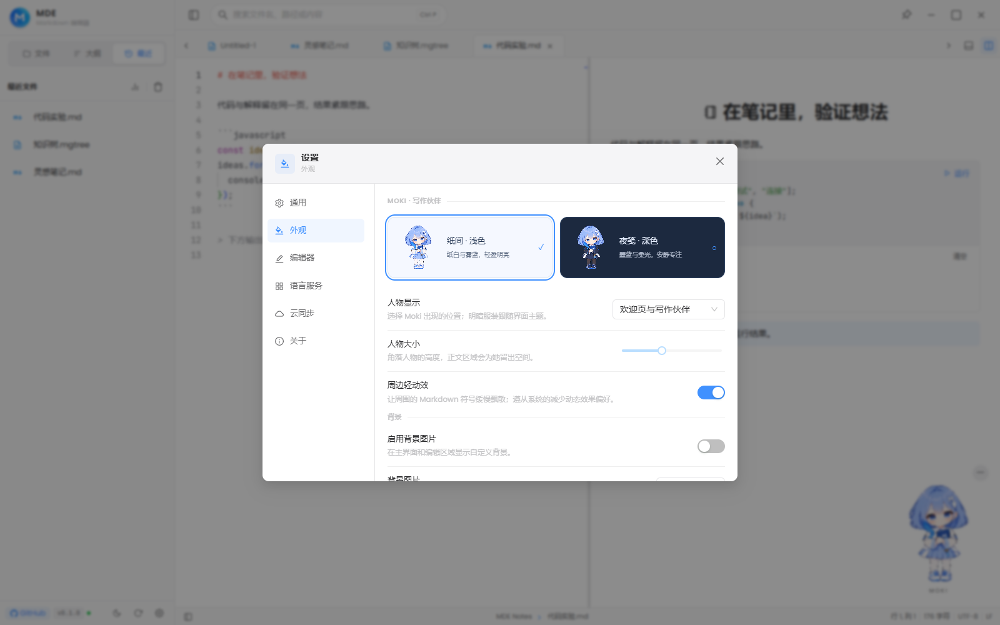

<p align="center">
  
</p>

<h1 align="center">MokiDown</h1>

<p align="center">A local-first personal workbench: writing, code, versions, and knowledge in one window.</p>

<p align="center">
  <a href="LICENSE"></a>
  
  
</p>

<p align="center">
  <a href="https://www.miaogu.xyz/">Live demo</a> ·
  <a href="https://github.com/hhyufan/mde-tauri/releases">Download</a> ·
  <a href="#-screenshots">Screenshots</a> ·
  <a href="#quick-start">Quick start</a> ·
  <a href="docs/Function/README.md">Feature docs</a> ·
  <a href="README.md">中文</a>
</p>

## Overview

MokiDown is a **local-first personal workbench**.

It starts from Markdown editing, but is no longer just an editor: files, code, version history, plugins, and reading views are organized around the same local workspace. The daily loop of *write → run → compare → roll back* stays in one window, without moving content between separate tools.

The workbench follows four principles:

* **Files are the source of truth**: read and write local files directly, with no private database; the workspace opens on any machine.
* **Keep the workflow in place**: edit, run code, inspect Git changes, compare history, and write back without leaving the workspace.
* **Extend rather than pile up**: language services, sync, file icons, and Markdown styles plug in around a small core.
* **Offline by default**: no login and no network required; history and versions stay on your machine.

<p align="center">
  
</p>

## Capabilities

### Writing and rendering

* **Three editing modes**: source, WYSIWYG, and split view, with GFM, LaTeX math, and Mermaid diagrams.
* **Virtual rendering**: inline code, bold, italic, strikethrough, links, and math render in place, with delimiters that follow the caret.
* **Math**: inline math adds a KaTeX live preview bubble, symbol completion, and paired input gestures; block math shares one layout with preview.
* **Markdown preview**: tables, task lists, footnotes, quotes, images, Mermaid, and KaTeX; code blocks wrap instead of scrolling horizontally.
* **Folding and outline**: headings, task lists, regular lists, and code blocks fold; the outline follows the caret.
* **Typographic details**: Monaco and code blocks share rainbow indentation (auto-detects 2/4-space units), and a blue I-beam cursor is shared by editor and preview.

### Code and execution

* **Runnable code blocks**: on desktop, run C#, JavaScript, Python, Java, Kotlin, and Rust with output, interactive input, and stop; the matching language runtime must be installed.
* **Language services**: install LSP plugins on demand for completion, hover info, and diagnostics.
* **Source editing**: Monaco provides multi-cursor, find and replace, folding, and code navigation.
* **Terminal**: an integrated terminal runs commands in the current workspace.
* **Command palette**: common actions, file jumps, and view switches in one entry point.

### Versions and history

* **Git workspace**: the Changes panel lists staged and working-tree changes by file mtime and watches the repository automatically, with a Markdown-only filter, branch switching, and open on GitHub.
* **History comparison**: Markdown files open in rendered diff by default; the right side is editable with per-line revert, save, and revert-all. Each comparison gets its own tab and does not overwrite the file being edited.
* **Local history**: file snapshots and version lists stay on the machine and can roll back to any version.
* **Git file history**: tracks local branches, remote-tracking branches, and the checked-out commit for a file, following renames across paths.

### Extensions and plugins

* **Plugin SDK**: a versioned capability catalog and permission model (commands, document / selection access, workspace files, network, plugin storage, status bar, file icons, notifications, Markdown styles, theme).
* **Built-in plugins**: incremental sync (standalone implementation, off by default) and the plugin panel (install, enable, disable, configure).
* **Extension points**: commands, status bar, file icons, Markdown styles, notifications, theme observation, and lifecycle cleanup.

### Files and workspace

* **Tabs**: open files and comparisons side by side without stealing the current tab.
* **File and project trees**: directory browsing, breadcrumb jumps, context menus, and file operations.
* **Find and locate**: global search, outline, bookmarks, and recent files.
* **Auto-save**: external-change detection and conflict handling, backed by local history.
* **Reading and split view**: multi-window reader, web split view, and live HTML preview.
* **Knowledge trees**: organize note hierarchy with `.mgtree` files, with node editing and jumps to document code blocks.
* **Import paths**: file drop, image insertion, and Markdown paste conversion.

### Personalization and mobile

* **Theme and appearance**: light / dark themes, wallpapers and opacity, Chinese / English UI, fonts, line height, and indent width.
* **Interaction preferences**: custom hotkeys, command palette, and settings search.
* **Android**: responsive layout with platform-specific file access; see the build section below.

## 📸 Screenshots

|            Sunny note · Light welcome           |           Night read · Dark welcome           |
| :---------------------------------------------: | :-------------------------------------------: |
|  |  |

| Three editing modes (source / WYSIWYG / split) |               Tree editor (mgtree)               |
| :--------------------------------------------: | :----------------------------------------------: |
|  |  |

|          Running code blocks         |
| :----------------------------------: |
|  |

|                 Dark editing                 |           Appearance and character settings          |
| :------------------------------------------: | :--------------------------------------------------: |
|  |  |

Captured from the running application with sample documents. Code output uses demonstration data in the real components; these images do not indicate browser access to the desktop execution engine. [Mobile welcome](screenshots/welcome-mobile.png) · [Design and capture notes](docs/character-design/moki-integration.md)

## Installation

See [Releases](https://github.com/hhyufan/mde-tauri/releases) for the available installers: on Windows the EXE (NSIS) is recommended, and the MSI also works. What other platforms ship depends on what each release actually provides.

The [live demo](https://www.miaogu.xyz/) shows the interface without installing; the browser demo cannot execute code locally the way the desktop app does. Android also differs in file access and local script execution.

## Quick start

The official incremental document sync service is included as an independent plugin under **Settings → Language services → Service plugins**, disabled by default. Configure your own endpoint, access key and folder; no account login is required. Its implementation runs only while enabled. [Plugin guide](plugins/README.md) · [Server and database setup](services/sync-server/README.md) · [API documentation](services/sync-server/docs/API.md)

### Local development

Prepare Node.js (22 is recommended, matching CI), a stable Rust toolchain, and the Tauri build dependencies for your platform. On Windows you also need the MSVC C++ toolchain, the Windows SDK, and WebView2.

From the repository root:

```bash
npm ci --legacy-peer-deps
npm run tauri:dev
```

To debug the frontend only, run `npm run dev`. Common commands:

| Command               | Purpose                                        |
| --------------------- | ---------------------------------------------- |
| `npm run build`       | Build the frontend and the live-showcase entry |
| `npm run tauri:build` | Build the Windows React installer              |
| `npm run check`       | Run lint, tests, build, and the bundle check   |

Desktop installers are written to `src-tauri/target/release/react/`. Sample documents and code live in [examples](examples/README.md).

### Android build

Install Android Studio (SDK / NDK / Build Tools) and JDK 17–21, configure `JAVA_HOME` and `ANDROID_HOME`, then run:

```bash
npm run tauri:android:init
npm run tauri:android:build
```

### Cloud sync (archived)

The cloud sync implementation has been removed from the main project and archived at [archive/cloud-sync](archive/cloud-sync/README.md) for reference or standalone open-source use. MokiDown now runs fully locally: no server, and your documents never leave your machine.

## Docs and contributing

* [Feature docs](docs/Function/README.md) · [Language services](docs/语言服务.md) · [Local script execution](docs/本地脚本运行.md)

* [Sample workspace](examples/README.md) · [Shortcuts](examples/notes/shortcuts.md) · [More screenshots](screenshots/)

* Report problems or open a Pull Request via [Issues](https://github.com/hhyufan/mde-tauri/issues).

Licensed under the [MIT License](LICENSE).
